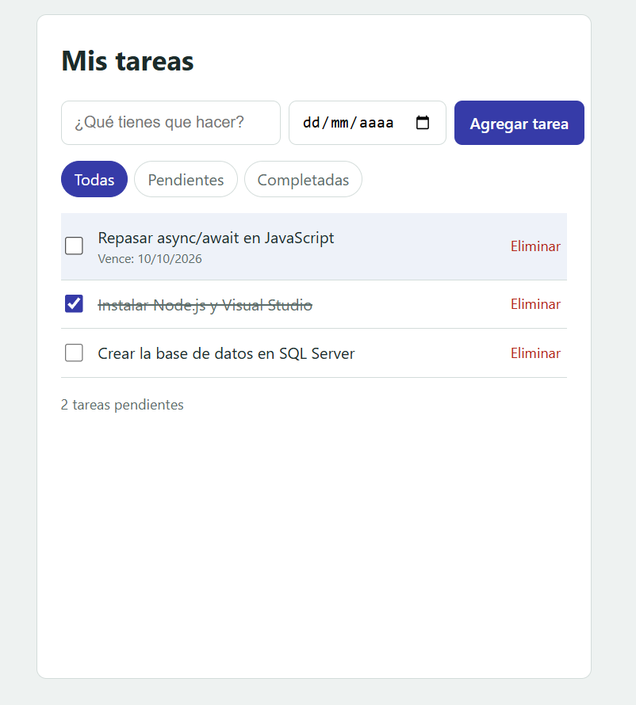

# Proyecto Tareas



Aplicación de lista de tareas fullstack, construida por partes como proyecto de práctica: web, app móvil, API y base de datos.

## Tecnologías

- **Web:** HTML, CSS y JavaScript
> Por ahora la web carga tareas de ejemplo desde una API pública de prueba (JSONPlaceholder); más adelante usará la API propia en C#.
- **Backend:** C# con ASP.NET Core, LINQ e inyección de dependencias
- **Base de datos:** SQL Server
- **Móvil:** React Native

## Estructura

```
proyecto-tareas/
  web/        Aplicación web
  api/        API en C# (ASP.NET Core)
  database/   Scripts de SQL Server
  mobile/     App móvil (React Native)
```
## Estado del proyecto

- [x] Parte 1: estructura HTML y estilos CSS
- [x] Parte 2: JavaScript (agregar, marcar, editar, eliminar, filtrar y ordenar tareas) y primera petición con `fetch` a una API de prueba
- [ ] Parte 3: API en C# con ASP.NET Core, SQL Server y EF Core
- [ ] Parte 4: integración de la web con la API
- [ ] Parte 5: DTOs, validaciones, servicios, repositorios, pruebas y seguridad
- [ ] Parte 6: app móvil con React Native

## Cómo ejecutar la parte web

1. Clona el repositorio.
2. Abre la carpeta `web/`.
3. Abre `index.html` en el navegador (o usa la extensión Live Server de VS Code).

## Cómo ejecutar la API

Requiere el SDK de .NET (probado con .NET 10).

1. Abre una terminal en `api/TareasApi`.
2. Ejecuta `dotnet run`.
3. Abre en el navegador la dirección que muestra la terminal (`Now listening on: ...`) seguida de `/api/tareas`.

Endpoints disponibles por ahora (los datos viven en memoria): `GET /api/tareas`, `GET /api/tareas/{id}`, `POST /api/tareas`, `PUT /api/tareas/{id}` y `DELETE /api/tareas/{id}`.

> Las instrucciones de las demás partes se irán agregando a medida que avance el proyecto.
